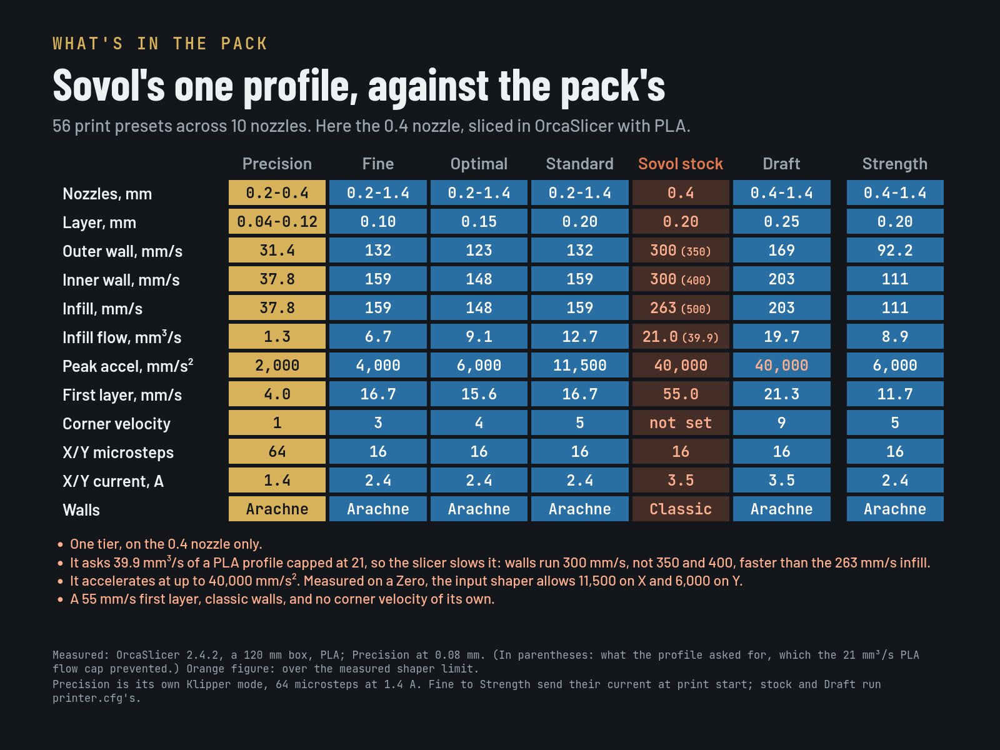
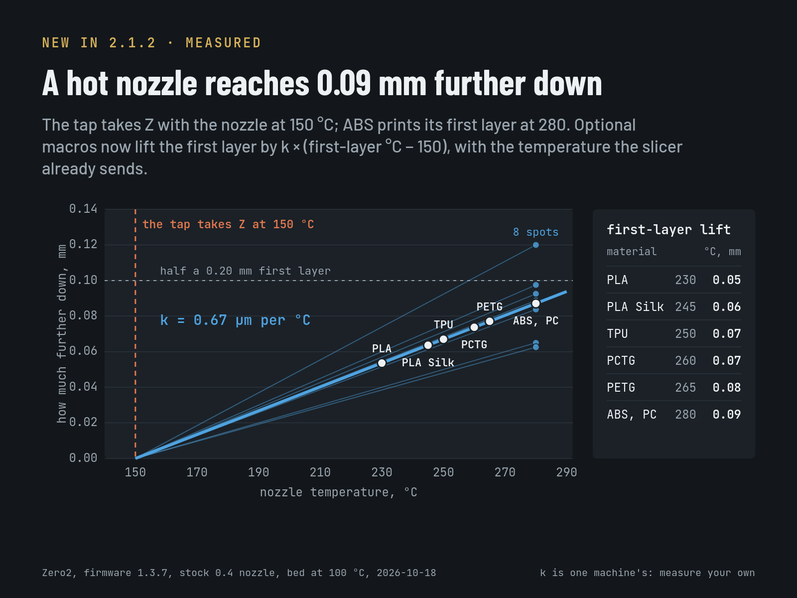
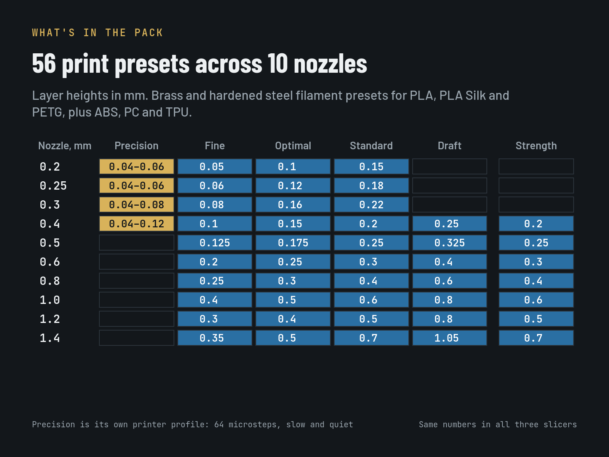
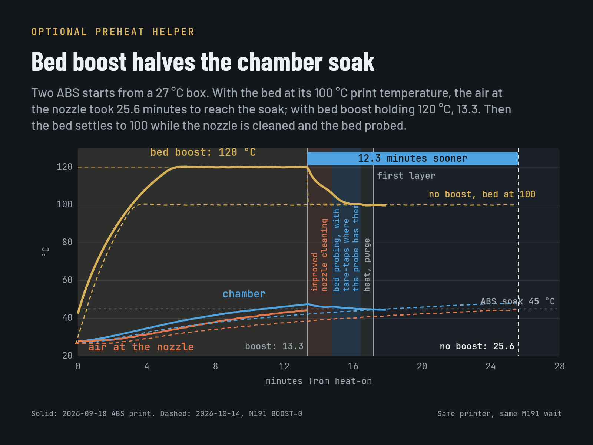
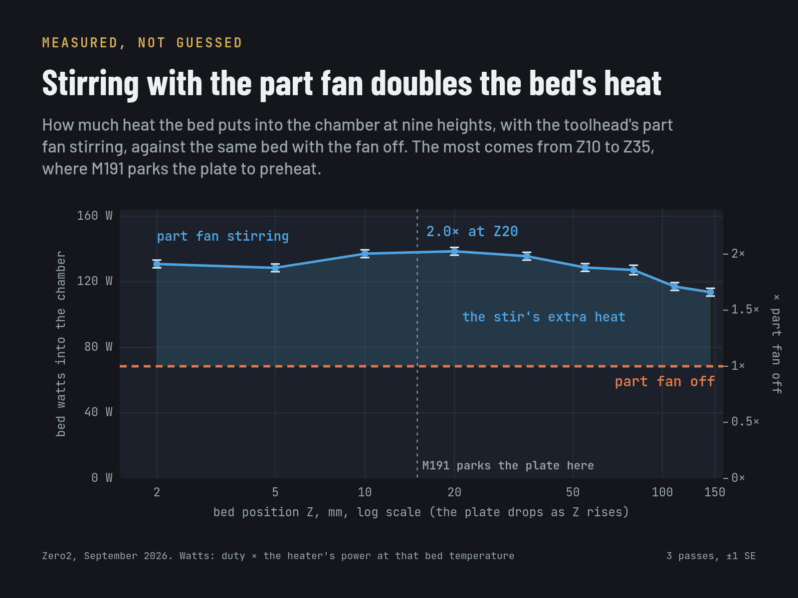
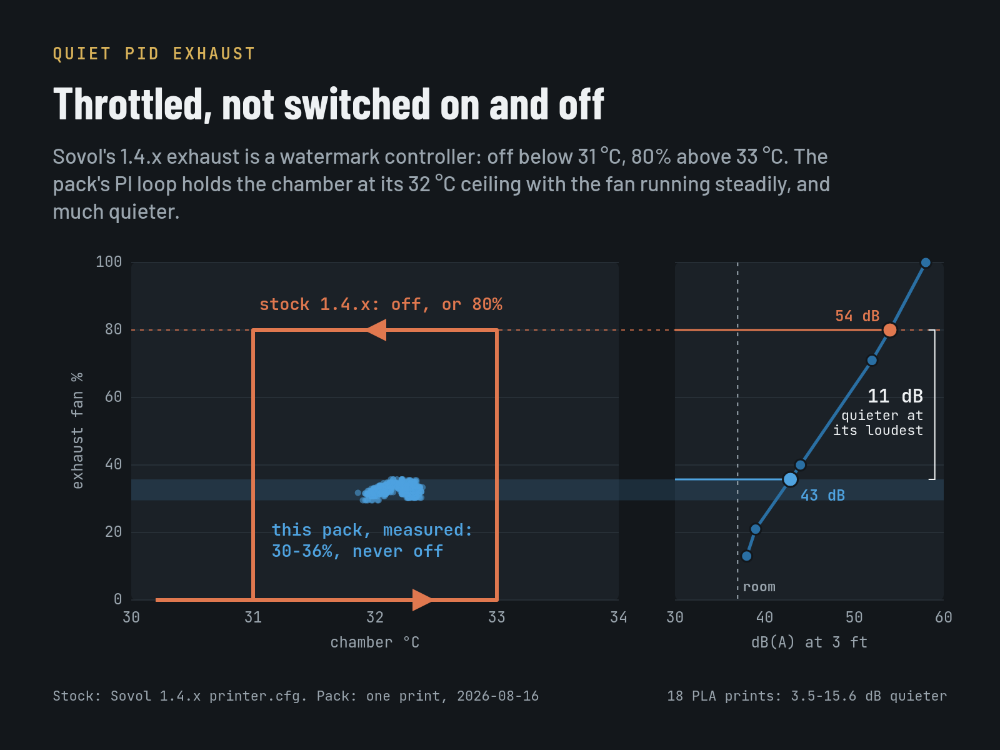
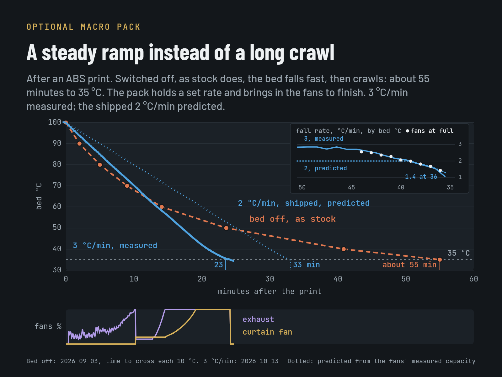
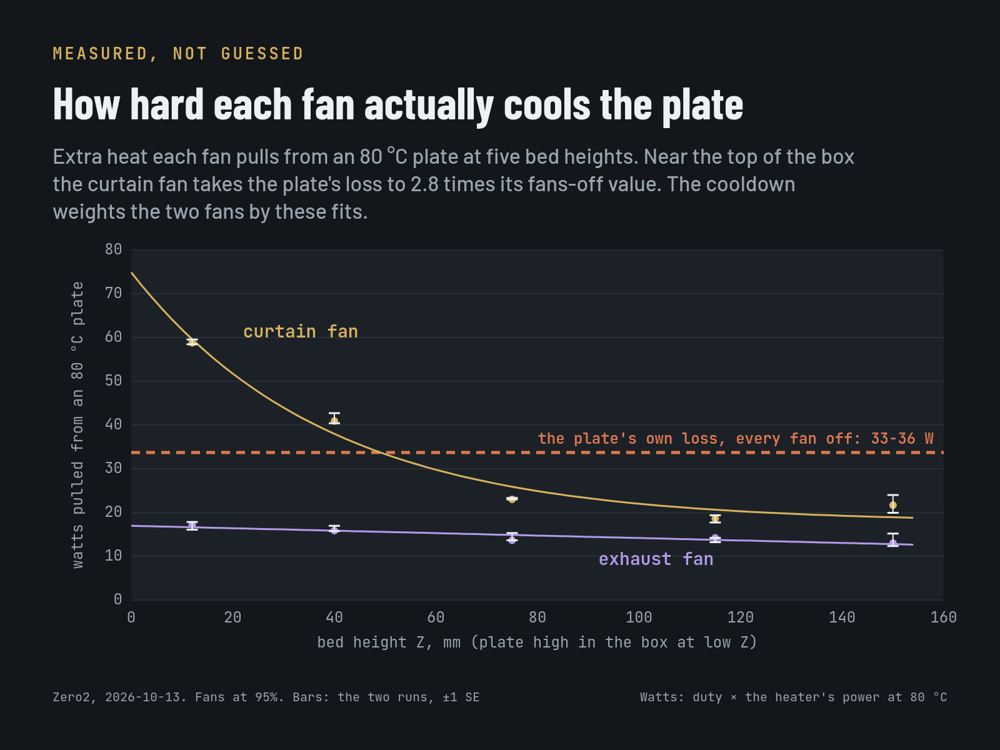

# SV Zero profiles

**[Download the latest release — v2.1.1](https://github.com/rpcyan586/svzero-profiles/releases/tag/v2.1.1)**

[OrcaSlicer ZIP](https://github.com/rpcyan586/svzero-profiles/releases/download/v2.1.1/svzero-profiles-2.1.1-orcaslicer.zip) ·
[PrusaSlicer ZIP](https://github.com/rpcyan586/svzero-profiles/releases/download/v2.1.1/svzero-profiles-2.1.1-prusaslicer.zip) ·
[SuperSlicer ZIP](https://github.com/rpcyan586/svzero-profiles/releases/download/v2.1.1/svzero-profiles-2.1.1-superslicer.zip)

[Source in Git](https://github.com/rpcyan586/svzero-profiles) ·
[Checksums](https://github.com/rpcyan586/svzero-profiles/releases/download/v2.1.1/SHA256SUMS) ·
[All releases](https://github.com/rpcyan586/svzero-profiles/releases)

Each ZIP includes its installation guide and the optional printer macro pack.

Profiles for **OrcaSlicer, PrusaSlicer and SuperSlicer** on the
Sovol Zero. One source generates the profiles for all three slicers.

Automated checks and slicing have passed;
physical testing of the latest stock-firmware fallback is still pending.
Read [validation and limitations](docs/VALIDATION.md) before testing.

The profiles cover ten nozzle sizes (0.2–1.4 mm), material settings and
Fine/Optimal/Standard/Draft/Strength tiers where supported. An optional
[precision mode](docs/PRECISION.md) adds slow, quiet, fine-detail printing on
the 0.4 nozzle and the smaller ones. Added nozzle sizes
are starting points, not evidence that a nozzle fits or has been flow-calibrated.

<p></p>

<p></p>

<p>






</p>

## Try the profiles

Start with **profiles only** on stock Sovol firmware. Added printer macros and
Python helpers are optional. Public startup retains `PURGE_LINE` and a priming
skirt: stock firmware warns about the missing macro and continues; the skirt
provides priming. Do not disable it unless another priming routine is installed.

Download the ZIP named for your slicer and follow its included README. Its
installation layout can differ from the development checkout below. See the
[download contents](docs/DOWNLOADS.md) for its installation files.

From a **Git checkout**:

1. Read [INSTALL.md](INSTALL.md) for the firmware requirements.
2. **PrusaSlicer / SuperSlicer:** import the corresponding INI from `bundles/`
   using File → Import → Import Config Bundle.
3. **OrcaSlicer:** with Orca closed, copy `bundles/orca-vendor/SVZero.json` and
   `bundles/orca-vendor/SVZero/` together into its configuration directory's
   `system/` directory. Enable SV Zero in printer selection and select the
   physically installed nozzle. Keep the entire vendor folder together.
4. Select a print and filament preset, configure your own printer connection,
   and inspect the first-layer preview. Old projects can retain old settings;
   explicitly reselect the new presets and re-slice.

For an isolated **Linux trial from a Git clone**, the installer can prepare a
new data directory:

```sh
python3 tools/install-presets.py orca "$HOME/svzero-orca"
flatpak run com.orcaslicer.OrcaSlicer --datadir "$HOME/svzero-orca"
```

Use a dedicated directory: the installer replaces SVZero presets and selects
its defaults. It is not a general-purpose configuration merger. Keep the data
directory under your home directory for Flatpak access. It does not launch a
print or configure a printer connection. `--accel-cap N` caps installed motion
settings when your machine uses a lower acceleration limit than stock.
Windows/macOS manual installation needs feedback; it has not been tested
by this project.

## Optional enhancements

| Install | Gain | Without it |
|---|---|---|
| Profiles only | Nozzle/material settings, temperature waits, skirt | Uses stock Sovol start/end macros |
| Firmware-matched macro pack | Chamber control, rear-sensor soak, brush routine, positioned purge, first-layer nozzle growth compensation, cancellation and bed cooldown | Profiles still use stock behavior |
| Preheat Python helper | Nozzle-air qualification, history-assisted waiting, bed boost (on by default) and bounded early handover | Native rear-sensor wait |
| Spoolman helper | Material and remaining-filament check before heating | Check the spool yourself |
| Fan/camera helpers | Additional telemetry or tuning for separately configured hardware/services | Core profiles do not require them |

Copy one generated firmware file from `bundles/klipper/` and add its include;
the separate source files and build script remain available for development.
The macro pack needs commissioning, particularly brush clearances. The 1.4.x
installation replaces a stock fan section. Missing *configured* Python modules
prevent Klipper from loading: enable their includes only after installing the
modules. Exact dependencies, benefits, removal and fallback behavior are in
[INSTALL.md](INSTALL.md).

## Feedback and development

Report the release version, slicer version, firmware, nozzle, filament and
installation level. Include expected/actual behavior and a small reproducer;
remove host addresses, API keys and other personal data from attached projects
and logs. Use the [feedback template](.github/ISSUE_TEMPLATE/feedback.md).

- [Build and test](docs/DEVELOPMENT.md)
- [Download contents](docs/DOWNLOADS.md)
- [Release workflow](docs/RELEASING.md)
- [Changes](CHANGELOG.md)
- [Licences and upstream attribution](NOTICE)

## Repository layout

| Directory | Contents |
|---|---|
| [bundles/](bundles/) | Generated profiles and single-file firmware configs |
| [klipper/config/](klipper/config/) | Separate macro and hardware configuration sources |
| [klipper/](klipper/) | Optional Python helpers |
| [assets/](assets/) | Bed preview model, texture and credits |
| [source/](source/) | Profile settings, schemas and pinned upstream inputs |
| [tools/](tools/) | Generators, installers, release manifest and development dependencies |
| [tests/](tests/) | Automated checks |
| [docs/](docs/) | Development, download and validation guides |

GitHub is the intended source of truth. Printables downloads will mirror
reviewed GitHub releases, with matching versions and checksums. This repository
contains the profile product; research archives and personal printer settings
are not part of it.
